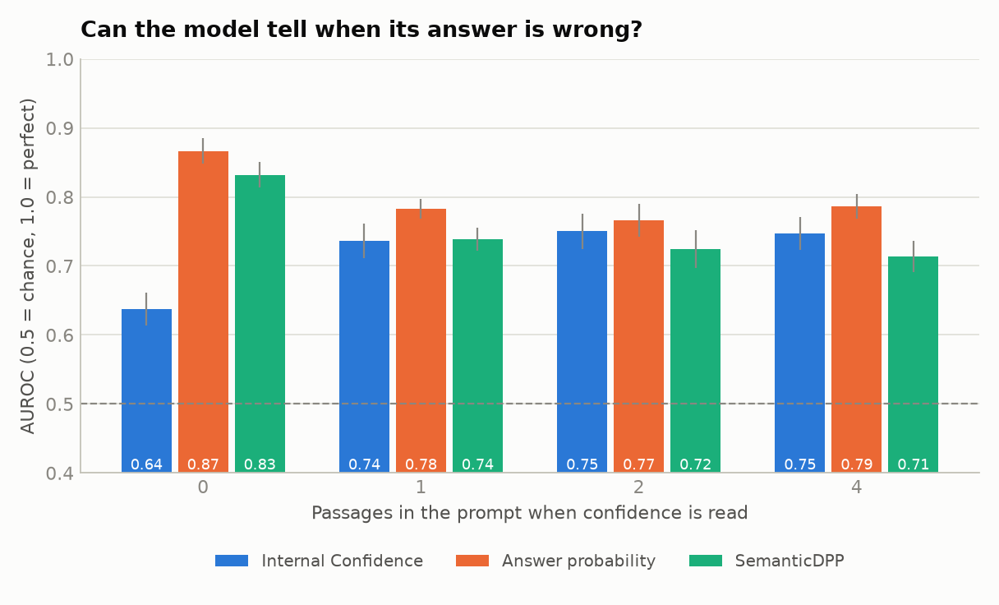
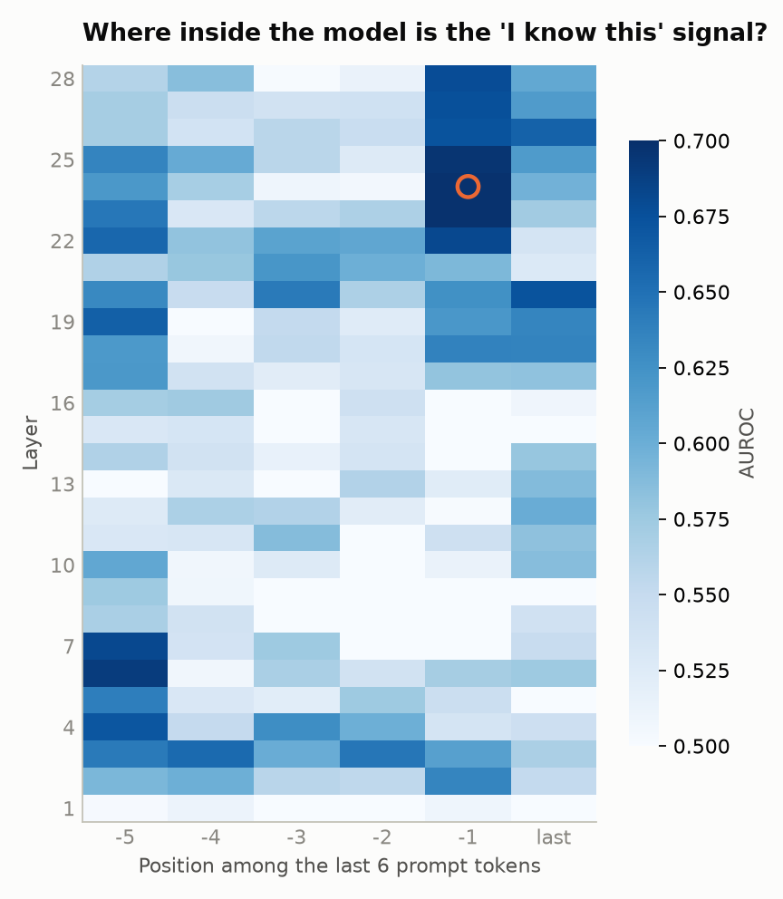
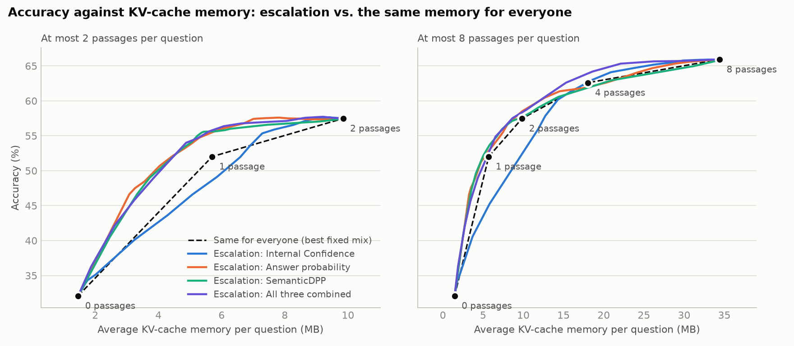
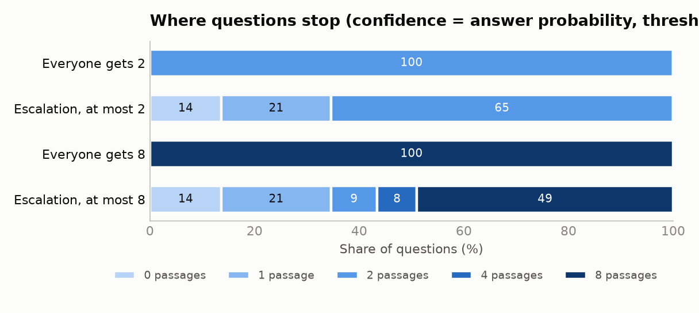

# Uncertainty for Optimal Memory Allocation — project overview

**DA4022, Project 7.** Team: Deval Singhal, Jayant Kumar, Sonal Mangesh Wagh, Sristi Vats, Shourya Veer Singh.

This document explains the whole project in plain language: the problem, the two
papers, our method, how we tested it, what we found, and where it falls short.
All numbers here come from real runs of a language model on our laptop. They
replace the numbers in the mid-term report, which came from a simulation.

---

## 1. The project in six sentences

1. When a language model answers a question with the help of retrieved text,
   that text sits in the model's **KV cache**, and the KV cache is the part of
   memory that grows with every extra token.
2. Normal systems give every question the same amount of retrieved text, so easy
   questions waste memory and hard ones may not get enough.
3. We let the model tell us how sure it is, and we give a question more memory
   **only while the model is still unsure**.
4. To measure "how sure", we use the two assigned papers — Internal Confidence
   and SemanticDPP — plus the probability the model gives its own answer.
5. On 400 TriviaQA questions, this reaches the same accuracy as "2 passages for
   everyone" with **21% less KV-cache memory**, and at very small memory budgets
   it is up to **7 accuracy points better** than any policy that ignores uncertainty.
6. The gain is real but modest, it costs extra time, and it shrinks when memory
   is plentiful; we explain why in Section 7.

---

## 2. Background

**KV cache.** A transformer reads the prompt once and stores, for every token and
every layer, a *key* and a *value* vector. While generating, it looks these up
instead of re-reading the prompt. That store is the KV cache. Its size is

```
KV bytes = tokens × 2 (key and value) × layers × KV heads × head size × bytes per number
```

For our model (Qwen2.5-1.5B in 16-bit floats: 28 layers, 2 KV heads, head size 128)
this is **28,672 bytes per token**. We checked the formula against the actual
cache tensors the model returns; it matches exactly. A 1,200-token prompt
therefore holds 34 MB of KV cache. That is per question: a server handling 64
questions at once would need 2.2 GB of KV cache for a model whose weights are
only 3.1 GB. This is why prompt length is a memory problem.

**Retrieval (RAG).** To answer factual questions, a system looks up passages of
text and pastes them into the prompt. More passages mean a better chance that the
answer is in there — and a proportionally bigger KV cache. So in this setting,

> **memory given to a question = number of passages in its prompt.**

That is the knob we control: 0, 1, 2, 4 or 8 passages.

**Uncertainty.** A number that says how likely the model is to be wrong. A good
uncertainty score is high on questions the model gets wrong and low on the ones
it gets right. We judge it with **AUROC**: the chance that a randomly picked
wrong answer has a higher uncertainty than a randomly picked right one (0.5 is
useless, 1.0 is perfect).

---

## 3. The two papers

### Paper A — Internal Confidence (Chen, de Melo, Suchanek, Varoquaux, ICLR 2026)

*Idea:* before generating anything, ask the model
"Respond only with Yes or No: can you answer this question accurately?" and
look at how strongly its internal states lean towards "Yes".

*How:* one forward pass over that prompt. At every layer and at the last few
tokens, the hidden state is projected onto the "Yes" and "No" output tokens,
giving a P(Yes). These are averaged with weights that are largest at the last
layer and last token and fall off quickly ("attenuated encoding", α = 1). The
result is one number, the Internal Confidence (IC).

*Good:* very cheap — no text is generated. *Limit:* the paper uses it for a
single yes/no decision (retrieve or not) made once, before retrieval.

### Paper B — SemanticDPP (anonymous, under review at ICLR 2026)

*Idea:* sample several answers to the same question. If they all mean the same
thing, the model is sure. If they scatter, it is guessing.

*How:* each sampled answer is represented by the model's own last-layer hidden
state, averaged over the answer's tokens. A small learned network maps these to
a space where distance means "difference in meaning". The answers' pairwise
similarities form a matrix, and the **log-determinant** of that matrix (through
a determinantal point process, DPP) measures how spread out the answers are.

*Good:* measures disagreement in meaning, not wording, without a second model.
*Limit:* needs several sampled answers, and the paper only uses the score to
decide whether to abstain.

### What neither paper does

Both produce an uncertainty number. Neither uses it to decide **how much
memory** a question should get. That is the question the course asked us.

---

## 4. Our method: Uncertainty-Calibrated Allocation (UCA)

### 4.1 The idea

Think of a student in an open-book exam. For an easy question they answer from
memory. If unsure, they open one page of the book and try again. Still unsure —
they read more. They stop as soon as they are confident, and they never read the
whole book for a question they already know.

UCA does the same for a language model:

```
level = 0 passages
loop:
    answer the question with the current passages
    read the model's confidence
    turn it into  p = probability that this answer is correct      (calibration)
    if p >= threshold, or the maximum number of passages is reached:
        stop and return the answer
    otherwise: add passages (0 -> 1 -> 2 -> 4 -> 8) and repeat
```

There are only two settings: the **threshold** (how sure is sure enough) and the
**maximum** number of passages. A low threshold saves a lot of memory and risks
some accuracy; a high threshold is cautious. The KV-cache memory a question ends
up using is the memory of the level where it stops.

### 4.2 Calibration — the "C" in UCA

Raw confidence scores are not probabilities. An IC of 0.6, a log-probability of
−0.4 and a DPP score of −20 cannot be compared with each other, or with a
threshold. So for each signal and each memory level we fit a simple rising
staircase (isotonic regression) on held-out questions that maps
*score → fraction of answers with that score that were correct*. After that,
"stop when p ≥ 0.7" means the same thing for every signal.

### 4.3 The confidence signals we plug in

| Signal | Where it comes from | Extra cost per check |
|---|---|---|
| **Internal Confidence** | Paper A, asked again at every level with the passages in the prompt (our extension; the paper only asks before retrieval) | one forward pass, no generation |
| **SemanticDPP** | Paper B, on 5 sampled answers at every level | 5 short sampled answers |
| **Answer probability** | probability the model gave to its own greedy answer — a standard baseline (Paper A calls it MSP) | nothing; it comes with the answer |
| **All three combined** | average of the three calibrated probabilities | all of the above |

### 4.4 What we compare against

- **Same memory for everyone:** every question gets k passages. We also allow
  the best *random mix* of two such settings (for example 60% of questions get
  1 passage and 40% get 2). This is the strongest policy that does not look at
  uncertainty, and it is the dashed line in our main figure.
- **Decide once, before retrieval:** read the closed-book confidence one time and
  assign passages from that single number. This is Paper A's adaptive-RAG idea
  extended to several levels, and it was our own first attempt.
- **Oracle:** a cheat that knows the right answers and gives each question the
  cheapest level that works. Not achievable; it shows how much room there is.

---

## 5. Experimental setup

| | |
|---|---|
| Model | Qwen2.5-1.5B-Instruct, 16-bit floats, on an Apple M1 laptop with 8 GB RAM |
| Data | 400 questions from the TriviaQA validation set (used by both papers) |
| Retrieval | each question's Wikipedia evidence pages, cut into 100-word passages, ranked by BM25 |
| Memory levels | 0, 1, 2, 4, 8 passages ≈ 51, 199, 343, 629, 1,200 prompt tokens |
| Correctness | the answer contains one of TriviaQA's accepted aliases (after lower-casing and removing punctuation) |
| SemanticDPP | 5 samples, temperature 1.0, top-p 0.9; kernel trained on calibration questions |
| Evaluation | fit everything on 200 questions, test on the other 200; repeated for 20 random halvings; we report the mean and the spread (±) over the halvings |

We ran the model **once** on every question at every level and saved everything
(answers, timings, confidence signals). Any allocation policy can then be
evaluated exactly by looking up the saved answers, without running the model
again.

Two implementation points that mattered on small hardware:

- **Sampling from the shared prompt cache.** A naive implementation samples 5
  answers by running the prompt 5 times in a batch, which also holds 5 copies of
  the prompt's KV cache. We read the prompt once and decode all 5 samples from
  the same cached keys and values. With 4 passages in the prompt this cut the
  sampling time from about 7 s to about 1.4 s in our tests, and SemanticDPP no
  longer needs 5× the prompt memory.
- **Releasing the GPU cache after every question.** Without it, memory use on
  the 8 GB machine kept growing and the time per question roughly doubled.

---

## 6. Results

### 6.1 More memory helps — but not everyone, and not always

| Passages for everyone | Accuracy | Prompt tokens | KV cache per question | Time per question |
|---|---|---|---|---|
| 0 | 32.1% | 51 | 1.5 MB | 0.46 s |
| 1 | 52.0% | 199 | 5.7 MB | 0.70 s |
| 2 | 57.5% | 343 | 9.8 MB | 1.05 s |
| 4 | 62.6% | 629 | 18.0 MB | 1.70 s |
| 8 | 65.9% | 1,200 | 34.4 MB | 3.37 s |

Going from 2 to 8 passages costs 3.5× the memory for 8 more points. Looking
inside these averages:

- Of the questions the model answers correctly **with no passages**, only 75%
  are still correct when given 1 passage (82% with 8). Retrieved text can
  distract the model from something it already knew. Giving these questions
  memory is worse than useless.
- Of the questions it gets wrong with no passages, 41% are fixed by 1 passage
  and 59% by 8.
- 77.5% of questions are answered correctly at *some* level, but the best single
  level only reaches 65.9%. The oracle reaches 77.4% using just 5.7 MB per
  question.

So there is a lot to gain from giving each question the right amount. The
question is whether uncertainty can find it.

### 6.2 Can the model tell when it is wrong?

AUROC for telling right answers from wrong ones, on held-out questions:

| Confidence signal | 0 passages | 1 | 2 | 4 |
|---|---|---|---|---|
| Internal Confidence (Paper A) | 0.64 | 0.74 | 0.75 | 0.75 |
| — P(Yes), last layer and token only | 0.60 | 0.73 | 0.75 | 0.75 |
| — P(Yes), plain average | 0.67 | 0.73 | 0.73 | 0.75 |
| SemanticDPP (Paper B) | 0.83 | 0.74 | 0.73 | 0.71 |
| — SemanticDPP, untrained kernel | 0.83 | 0.74 | 0.73 | 0.71 |
| — sampled answers agree (string match) | 0.84 | 0.74 | 0.72 | 0.71 |
| Answer probability | 0.87 | 0.78 | 0.77 | 0.79 |

(Spread over the 20 halvings is about ±0.02–0.03 for every cell.)



What this tells us:

- **Our Internal Confidence number is in line with Paper A.** With no passages
  we get 0.64; the paper reports 0.647 on TriviaQA for its smallest model
  (Phi-3, 3.8B) and up to 0.719 for a 14B model. Our model is smaller still.
- **Internal Confidence gets better once passages are in the prompt** (0.64 →
  0.75). Asking "can you answer this with what you have?" is an easier question
  for the model than "do you know this?". This re-asking with context is our
  extension of Paper A.
- **The two answer-based signals are strongest before retrieval** (0.83–0.87)
  and drop to 0.71–0.79 with passages. With passages the model's sampled answers
  agree far more often (on average 3.1 different answers out of 5 with no
  passages, 1.5 with four), including when they agree on a wrong answer copied
  from a misleading passage.
- **Honest note on SemanticDPP.** Our learned kernel is no better than an
  untrained one, and simply counting how many sampled answers match as strings
  does just as well. TriviaQA answers are one or two words, so there is little
  "same meaning, different wording" for the DPP to resolve, and we train it on
  only 200 questions with string-match labels instead of the paper's entailment
  model. On longer answers the picture may differ; we did not test that.

Where does the Internal Confidence signal live inside the model? Paper A reports
that the best place is not necessarily the last layer and last token. We see the
same: the best single cell is layer 24 of 28, one token before the end
(AUROC 0.70), against 0.61 at the very last cell.



### 6.3 Does uncertainty save memory?

The main figure. Each coloured line is our escalation policy with one confidence
signal, as the threshold moves from "always stop" (left) to "never stop early"
(right). The black dots are "same for everyone"; the dashed line joins them and
is the best any uncertainty-blind policy can do. **A coloured line above the
dashed line means: more accuracy from the same KV-cache memory.**



The same information as numbers, at one fixed threshold (stop when p ≥ 0.70):

**At most 2 passages** — compare with "everyone gets 2": 57.5% accuracy, 9.8 MB, 1.05 s

| Confidence signal | Accuracy | KV cache | Memory saved | Accuracy change | Gain over best blind mix at the same memory | Time |
|---|---|---|---|---|---|---|
| Answer probability | 57.6% | 7.8 MB | **21%** | +0.1 ± 0.8 | **+2.6 ± 1.0** | 1.75 s |
| SemanticDPP | 56.6% | 7.4 MB | 24% | −0.9 ± 1.2 | +2.2 ± 1.8 | 4.29 s |
| Internal Confidence | 57.2% | 8.7 MB | 12% | −0.3 ± 0.7 | +1.0 ± 0.9 | 1.72 s |
| All three combined | 57.6% | 8.6 MB | 12% | +0.1 ± 0.6 | +1.5 ± 1.1 | 5.51 s |

**At most 8 passages** — compare with "everyone gets 8": 65.9% accuracy, 34.4 MB, 3.37 s

| Confidence signal | Accuracy | KV cache | Memory saved | Accuracy change | Gain over best blind mix at the same memory | Time |
|---|---|---|---|---|---|---|
| All three combined | 65.3% | 22.1 MB | **36%** | −0.6 ± 1.1 | **+1.9 ± 1.5** | 12.05 s |
| Internal Confidence | 64.1% | 20.9 MB | 39% | −1.8 ± 1.8 | +0.9 ± 1.5 | 4.38 s |
| Answer probability | 62.6% | 20.4 MB | 41% | −3.3 ± 1.5 | −0.4 ± 1.3 | 4.36 s |
| SemanticDPP | 60.6% | 14.4 MB | 58% | −5.4 ± 2.3 | +0.2 ± 1.4 | 7.22 s |

How to read these:

- **With a small memory ceiling the method clearly works.** Using answer
  probability with at most 2 passages, we match "everyone gets 2" (57.6% vs
  57.5%) while holding 21% less KV cache. At a slightly lower threshold (0.60)
  the saving is 29% for the same accuracy (57.4%, 7.0 MB).
- **The biggest wins are at the smallest budgets.** With answer probability and
  at most 1 passage (threshold 0.25), we get 48.8% from 3.5 MB — **7.2 ± 1.8
  points more** than the best blind policy at that memory. At about the memory of
  "1 passage for everyone" (5.7 MB, 52.0%), escalation up to 2 passages reaches
  56.0% with 5.9 MB (+4.0 ± 1.5 at equal memory). This is the regime where the decision is mostly "does this
  question need retrieval at all?", and the model answers that well (AUROC 0.87).
- **With a large memory ceiling the gain mostly disappears.** Escalation up to 8
  passages saves 36–58% of the memory but gives up 1–5 points of accuracy, and
  against the best blind mix at the same memory it is roughly level (−0.4 to
  +1.9, about the size of the noise). Only the three signals combined stay close
  to the full accuracy (65.3% vs 65.9% with 36% less memory).
- **Internal Confidence alone is the weakest of the three** on this small model
  (+1 point). It becomes useful in combination, and Paper A reports that it
  improves with model size, which we could not test.

How the memory gets spent (answer probability, threshold 0.70): 14% of questions
stop with no passages and another 21% after one.



### 6.4 Deciding once, before retrieval, does not work here

Our first design read the closed-book confidence once and assigned passages from
it. Averaged over all budgets, its gain over the best blind mix was
**+0.3 ± 1.0** points with Internal Confidence and **0.0 ± 1.3** with an
IC-then-SemanticDPP cascade — nothing. The reason is simple once seen: two
thirds of the questions are wrong without passages and need retrieval anyway, and
closed-book confidence says nothing about *how many* passages will be enough.
Confidence has to be re-read after the memory is given. That observation is what
led to the escalation design.

### 6.5 What the confidence checks cost

Escalation saves memory, not time. Each extra level means reading a longer
prompt again:

| Check, by passages already in the prompt | 0 | 1 | 2 | 4 |
|---|---|---|---|---|
| Internal Confidence (one forward pass) | 0.25 s | 0.53 s | 0.86 s | 1.51 s |
| SemanticDPP (5 sampled answers from the shared cache) | 1.51 s | 1.39 s | 1.50 s | 1.54 s |
| Answer probability | free | free | free | free |

With at most 2 passages, the answer-probability policy takes 1.75 s per question
against 1.05 s for "everyone gets 2": **21% less memory for 67% more time.**
SemanticDPP costs about 4× the time. Internal Confidence was designed to be cheap
because it generates nothing, but once passages are in the prompt it has to read
them too, and its prompt is about 32 tokens longer than the answering prompt.
Peak memory is unaffected by the checks, because each check finishes before the
next level starts.

Most of the extra time is avoidable: when going from 1 to 2 passages, the first
passage is unchanged and its cached keys and values could be reused instead of
recomputed. We did not implement that (see Section 8).

---

## 7. What we learned, and the limits

1. **Uncertainty is most useful for the first decision** — whether a question
   needs any retrieved memory. There it gives clear gains (up to 7 points at
   equal memory).
2. **Uncertainty cannot tell which questions are hopeless.** About 22% of
   questions are wrong at every level. They look "unsure" all the way up, so an
   uncertainty-driven policy keeps feeding them memory that never pays off. The
   oracle avoids this; no confidence signal we tried can. This is the main
   reason the gain shrinks at large memory budgets.
3. **The cheapest signal was the best one.** The probability of the model's own
   answer beat both papers' methods on this task and costs nothing extra.
4. **Simple policies generalised; clever ones did not.** A rule based on
   expected accuracy gain per token, and thresholds tuned separately for every
   budget, both looked better on calibration questions and worse on test
   questions. With a few hundred questions to calibrate on, two settings are
   all we could choose reliably.

Limits of this study, stated plainly:

- **One small model, one dataset, 400 questions.** The ± values are the spread
  over random halvings of the same 400 questions, so they understate the true
  uncertainty. Differences of about 1 point should be treated as "no difference";
  the 2–7 point gains at small budgets are the ones we trust.
- **The headline threshold (0.70) and the form of the policy were settled after
  looking at the first 200 questions.** The full curves in the main figure do
  not depend on that choice.
- **Correctness is string matching** against TriviaQA aliases, which is strict
  on wording and occasionally lenient on short aliases.
- **Retrieval is BM25 over each question's own evidence pages**, an easier
  setting than searching all of Wikipedia.
- **Time goes up** with our implementation, as shown in 6.5.
- **Differences from the papers:** for Internal Confidence we read intermediate
  layers through the model's final normalisation layer; for SemanticDPP we use
  string-match clusters as training labels, PCA whitening to 32 dimensions, and
  5 samples.

---

## 8. What we would do next

- **Reuse the KV cache between escalation steps.** Put passages before the
  question so that adding a passage only appends to the prompt; then keep the
  cached part and compute only the new tokens. This should remove most of the
  time overhead.
- **A larger model.** Paper A shows Internal Confidence improving with model
  size; a 7–8B model on a GPU machine would test whether the pre-generation
  signal becomes competitive.
- **Detect hopeless questions.** For example by checking whether retrieval found
  anything relevant, so that memory is not spent where it cannot help.
- **Longer answers**, where SemanticDPP's meaning-based comparison should matter
  more than it does for one-word answers.

---

## 9. How to run it

See [README.md](README.md). In short: `python -m pytest tests -q` for the tests,
`python -m src.experiments.analyze` to regenerate every number and figure in
this document from the saved runs, and `python -m src.experiments.demo --n 10`
for a live run on questions the experiments never used.

---

## 10. Quick answers for the viva

**What exactly is the memory you are allocating?** The KV cache: 28,672 bytes for
every prompt token on our model. Passages are most of the prompt, so the number
of passages sets the memory.

**What is new compared with the two papers?** They measure uncertainty; we use it
to decide memory. Specifically: re-reading confidence after each memory increase
(the papers read it once), calibrating it into a probability so one threshold
works for any signal, and measuring the result in actual KV-cache bytes.

**Why not just give everyone 8 passages?** It costs 34 MB per question instead of
10 MB or less, and for questions the model already knows, passages lower
accuracy (only 75–82% of them stay correct).

**Is it "optimal"?** No. The oracle shows 77% accuracy is possible at 5.7 MB; we
are far from that. Our policy is a simple rule that is better than any
uncertainty-blind allocation at small and medium budgets.

**Why did the first design fail?** It decided once, before retrieval. Most
questions need retrieval regardless, and closed-book confidence cannot say how
much.

**Why is Internal Confidence weak here?** Small model. Our 0.64 matches what the
paper reports for small models; the paper's own numbers rise with size.

**What does it cost?** Time: about 67% more per question for the cheapest
signal, because each level re-reads the prompt. Reusing the cache between levels
would remove most of that.

---

## References

1. L. Chen, G. de Melo, F. M. Suchanek, G. Varoquaux. *Query-Level Uncertainty in Large Language Models.* ICLR 2026. https://openreview.net/pdf?id=11QZITAMUO
2. Anonymous. *SemanticDPP: Efficient Uncertainty Quantification in LLMs.* Under review at ICLR 2026. https://openreview.net/pdf?id=C8yjlrx4Wo
3. M. Joshi, E. Choi, D. Weld, L. Zettlemoyer. *TriviaQA: A Large Scale Distantly Supervised Challenge Dataset for Reading Comprehension.* ACL 2017.
